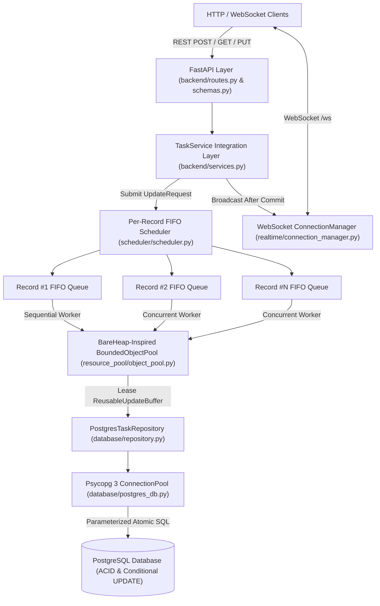
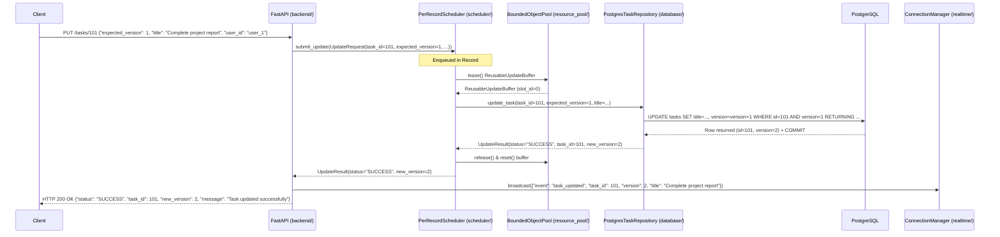
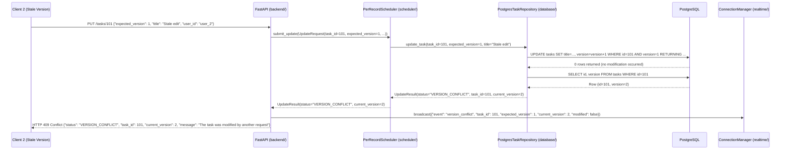

# ConcurrentHub Phase 2 — System Architecture

**Project ID:** OSDBMS-V-2026-T185  
**Team Name:** Team Nexus

---

## 1. High-Level Architecture Diagram



---

## 2. Sequence Diagram: Successful Version-Checked Update



---

## 3. Sequence Diagram: Stale-Version Conflict Rejection



---

## 4. Core Operating Systems (OS) Concepts Demonstrated

1. **Workload-Aware Scheduling:** Instead of treating all incoming requests as uniform tasks competing for a single lock, `PerRecordScheduler` partitions work by `task_id`.
2. **Per-Key FIFO Queues & Independent Progress:** Conflicting updates to the same record are serialized in a per-record `queue.Queue`, while updates to distinct record IDs run in parallel across worker threads in a `ThreadPoolExecutor`.
3. **Synchronization Primitives:** Fine-grained mutex locking (`threading.Lock`) protects the scheduler's bucket registry and the object pool's lease tracking set, while `asyncio.Lock` synchronizes WebSocket client registration.
4. **Bounded Resource Pooling:** `BoundedObjectPool` bounds the number of in-flight `ReusableUpdateBuffer` instances and recycles them across requests, preventing unbounded memory allocation bursts.

---

## 5. Core Database Management System (DBMS) Concepts Demonstrated

1. **ACID Transactions:** Every create and update operation runs inside a managed PostgreSQL transaction (`with pool.connection() as conn:`) that commits atomically on success or rolls back automatically on exception.
2. **Optimistic Concurrency Control (OCC):** Every task carries an integer `version` column initialized to `1`. Clients supply `expected_version` with every update.
3. **Atomic Conditional Updates (Lost-Update Prevention):**
   ```sql
   UPDATE tasks
   SET title = %(title)s,
       version = version + 1,
       updated_at = CURRENT_TIMESTAMP
   WHERE id = %(task_id)s
     AND version = %(expected_version)s
   RETURNING id, title, version, created_at, updated_at;
   ```
   PostgreSQL evaluates the `WHERE id = ... AND version = ...` predicate and increments `version` atomically while holding the row-level lock. The application queue reduces lock contention inside a single backend instance, while PostgreSQL remains the **final authority** guaranteeing zero lost updates even if multiple processes or external clients access the database simultaneously.
4. **Database Connection Pooling:** `PostgresPoolManager` reuses established PostgreSQL backend sessions via `psycopg_pool.ConnectionPool`, eliminating per-request TCP/TLS/authentication overhead.
